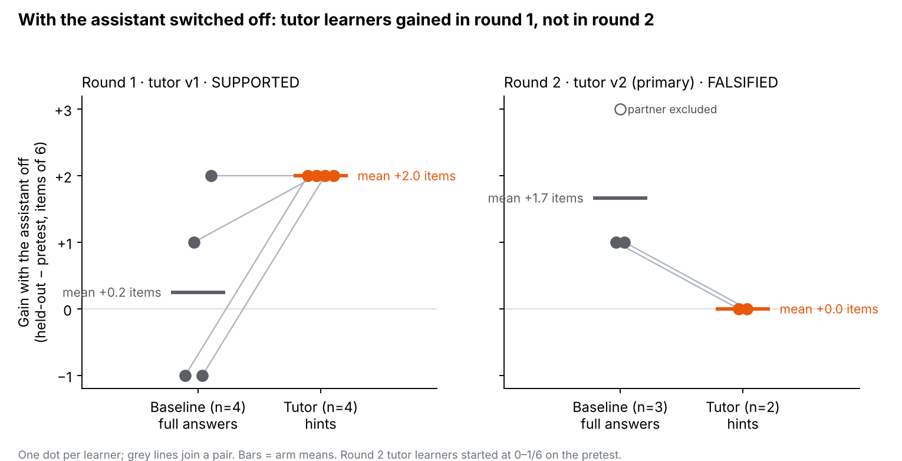
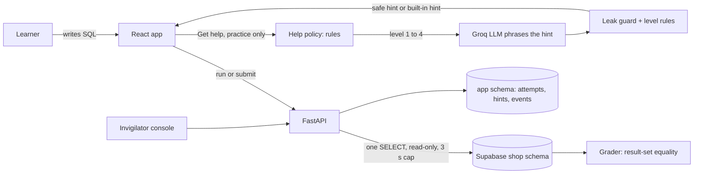

# Learning OS 🧠

**An SQL tutor that refuses to give you the answer, tested with the AI switched off.**

Chatbots write a query in four seconds, and the skill quietly disappears. Learning OS holds back help on purpose: it points at your mistake instead of fixing it. Then it checks what you can do on your own, days later, with no AI at all.

**Live:** [learning-os-uon2.onrender.com](https://learning-os-uon2.onrender.com) · 100xEngineers C7 Capstone, Module 3

---

## Result

14 real learners (13 analysed; 1 excluded for using ChatGPT). Tutor vs an answer-giving assistant. A held-out test 2–4 days later, with the AI off.

**Pre-registered rule:** the tutor wins if its mean gain beats baseline by at least 1 question **and** it wins at least ⅔ of the matched pairs. The mirror image is *falsified*; anything else is *inconclusive*.

| | Tutor | Answer-giver | Verdict |
|---|---|---|---|
| Round 2 (tutor v2, primary) | +0.0 | +1.7 | ❌ Falsified |
| Round 1 (tutor v1) | **+2.0** | +0.25 | ✅ Supported |
| Pooled | +1.3 | +0.9 | Inconclusive |

*Gain = questions correct on the final test minus the pretest, out of 6.*

**Takeaway:** holding back answers helped learners who could *start* a query, and failed those who couldn't. **Withholding needs a floor.** Tutor practice completion also collapsed (4.5 vs 6.4 of 8 solved).

**How the evidence changed the hypothesis**

| v1 (before) | v2 (after) |
|---|---|
| Capping help improves unaided performance | It does, **for learners at the edge of a skill**. Below that edge, show a worked example first |
| Cap the hint button | Cap **every** channel: half the leaks came through SQL-error explanations |
| (unstated) | A hint may only use what is already in the learner's own query or error |



---

## How it works

1. **Pretest (15 min):** 6 join questions, no help.
2. **Practice (45 min):** 8 questions with a **Get help** button.
   - **Tutor arm:** a 4-step hint ladder (point at the problem → explain the idea → skeleton with blanks → exact fix). It never gives the full query.
   - **Baseline arm:** the full correct query, like ChatGPT.
3. **Final test (30 min, 2+ days later):** 8 new questions, **no help at all**.
4. Everything is graded by the result set, against a real Postgres database.



**Rules decide how much help you get; the LLM only phrases it.**

| Part | Kind | Job |
|---|---|---|
| Grader, SQL sandbox, timers | Deterministic | Result-set grading; one read-only SELECT; the server-side clock |
| Help policy + leak guard | Deterministic | Chooses the hint level; blocks any reply whose SQL produces the answer |
| Hint wording | Probabilistic (LLM) | Groq phrases the hint at that level; a built-in hint if it fails |
| Sessions, pairing, invigilation | Human | Starts phases, coin-flip assignment, exclusions, export |

---

## Features

- ⏱️ Server-enforced timers with auto-submit
- 🪜 Help level chosen by how close your last attempt was, not by how often you click
- 🛡️ Read-only SQL sandbox (one SELECT, 3 s cap, row limits)
- 🎲 Fair assignment: pairs matched on pretest score, then a coin flip
- 🧑‍🏫 Invigilator console: phases, arms, live stats, one-click export
- 🌗 Light and dark mode

## Tech stack

| Layer | Tech |
|---|---|
| Frontend | React, Vite, Tailwind, CodeMirror |
| Backend | FastAPI (Python) |
| Database | Supabase Postgres |
| LLM | Groq: gpt-oss-120b (+2 fallback models) |
| Hosting | Render |
| Tests | pytest (72 tests) |

## The experiment, in the open

- [`docs/preregistration.md`](docs/preregistration.md): the decision rule, published before the results, plus every deviation
- [`docs/hypothesis-log.md`](docs/hypothesis-log.md): how the evidence changed the hypothesis (v1 → v2)
- [`docs/llm-analysis-round1.md`](docs/llm-analysis-round1.md): every tutor reply, graded by hand
- [`results/`](results/): anonymised scores per learner

## Limitations

- Small n (2 matched pairs in the primary test), so this is a direction, not proof.
- The two rounds differ in tutor version, learner level and test timing.
- All sessions ran remotely and unsupervised. Tab switches were logged, and a pre-registered rule handles them; it changes no verdict.
- A 2–4 day gap measures short-term retention, not 6 weeks.

## Run it locally

```bash
cp .env.example .env                 # Supabase URLs, ADMIN_TOKEN, GROQ_API_KEY
python3 -m venv .venv && source .venv/bin/activate
pip install -r requirements.txt
bash scripts/reset_db.sh             # schema + seed + answers
cd backend && uvicorn app.main:app   # learner: /   invigilator: /admin
```

---

Built by **Ram Smaran H** ([@Fireball555](https://github.com/Fireball555))
