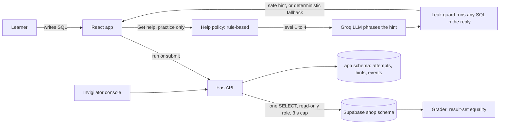

# Learning OS: Assisted Independence

**Does an AI tutor that holds back help make learners better at SQL once the AI is switched off?**

When a learner pastes a question into a chatbot, they get the full query in four seconds, and six weeks later they can't start one alone. This project tests the alternative. An adaptive SQL tutor caps how much it reveals, based on what each learner has already shown they can do unaided. Then a **removal test** checks what they can do with the assistant gone, compared against learners who used an ordinary answer-giving assistant.

> 100xEngineers C7 Capstone · Module 3 · Learning OS brief
> Status: round 1 ran on 10 Nov (tutor v1), round 2 on 11 Nov (tutor v2), and the removal test is on 13 Nov. Results go in `results/` and the case study.

---

## The experiment

| | |
|---|---|
| **Hypothesis (v1)** | Help capped at what the learner can already do unaided leads to higher scores on held-out multi-table questions, with no assistant, than an assistant that gives the full query on request. Practice completion stays comparable. |
| **Learners** | At least 6 people (about 9 expected), none on the team, who know SELECT/WHERE/GROUP BY but have not been taught joins. Pilot runs are excluded from results. |
| **Arms** | **Tutor**: a hint ladder that never gives the query. **Baseline**: the full correct query on every request. Same app, model, UI and button. |
| **Assignment** | Rank by pretest score, pair neighbours, then a coin flip inside each pair. |
| **Sessions** | Pretest 15 min, then practice 45 min, then (2 days later) removal test 30 min. All three are timed by the server. |
| **Primary metric** | Skill-matched gain: (held-out H1–H6 correct ÷ 6) − (pretest P1–P6 correct ÷ 6). |
| **Decision rule** | **Supported**: the tutor mean gain is at least 1 question higher than baseline, **and** the tutor learner wins in at least two-thirds of the pairs. The mirror image is **falsified**; anything else is inconclusive. |
| **Collapse check** | Tutor practice completion below 0.75 × baseline means completion has collapsed. |

Full pre-registration: [`docs/preregistration.md`](docs/preregistration.md). Session procedure: [`docs/runbook.md`](docs/runbook.md).

## How it works



| Part | Kind | Where |
|---|---|---|
| Grading (result-set equality, columns by position, values normalised) | Deterministic | `backend/app/grader.py` |
| SQL sandbox: read-only role, one SELECT, server-side cursor, row/byte/time caps | Deterministic | `backend/app/sandbox.py` |
| Help-level policy: mastery + attempts → level | Deterministic | `backend/app/policy.py` |
| Leak guard: block any reply whose SQL returns the right answer or copies the reference | Deterministic | `backend/app/assistant.py` |
| Phrasing the hint at the chosen level (Groq; fallback chain of models on rate limits) | **Probabilistic (LLM)** | `backend/app/assistant.py` |
| Running sessions, invigilating, observations | **Human** | `/admin` console |

**The tutor ladder:**
- **L1 symptom:** a question about what is wrong with their result. Names no SQL feature, table or column.
- **L2 concept:** explains the idea behind the fix, in words.
- **L3 skeleton:** one sentence plus the solution's shape with `___` blanks (made by code, never runs).
- **L4 fix:** the exact change to the learner's own attempt, as a fragment.

**Tutor v2 (from 11 Nov, after round 1):** a hint may use anything already in the learner's own query or the error message, and may never introduce a new SQL feature or new code before L2. Get help unlocks again only after a new run. See [`docs/llm-analysis-round1.md`](docs/llm-analysis-round1.md).

**How the ladder moves (policy v3):** every hint is about the learner's own latest query. The rules look at how close it is, as measured by the grader:
- SQL error: explain the error. This doesn't use up a rung.
- Close (right rows, only the columns or order wrong): straight to L4. A `SELECT *` on the wrong rows is not close.
- A few rows off: up two levels. This is often the concept itself, such as an inner join where a left join is needed.
- Far: one step up per new attempt.

If the learner has already shown a skill unaided, they must try once first. Asking again without trying repeats the last hint. After L4 and 2 more failed runs, the learner may choose **Show solution**, which is logged, and that question then doesn't count as solved.

**Rules enforced on the server, not the UI:**
- A learner only ever receives the questions of their current phase.
- `/help` doesn't exist outside practice: it returns 404.
- The arm is never sent to or from the browser.
- Test phases never reveal whether an answer is correct.
- A database outage is never recorded as a wrong answer.

## Repository map
```
backend/app/
  main.py            API: phases, timer, run/submit/help, admin, export
  question_bank.py   22 questions (6 pretest / 8 practice / 8 held-out), the single source of truth
  questions.json     frozen expected result sets (scripts/build_questions.py)
  grader.py  sandbox.py  policy.py  assistant.py  db.py  config.py
backend/tests/       71 tests: grader, policy, sandbox security, 30 trap/alternative queries,
                     full study flow, races, outages, timer, leak guard
frontend/            React + Vite + Tailwind + CodeMirror (dist/ is committed and served by FastAPI)
db/                  schema, deterministic seed generator, app tables + read-only role
scripts/             reset_db.sh, build_questions.py, analyze.py
docs/                preregistration.md, runbook.md, hypothesis-log.md, viva-notes.md,
                     llm-analysis-round1.md, evidence-checklist.md
```

## Run it

**Requirements:** Python 3.12+, `psql` (`sudo apt install postgresql-client`), a Supabase project, and a Groq API key.

```bash
cp .env.example .env               # 2 DB URLs (Session/Transaction pooler), ADMIN_TOKEN, GROQ_API_KEY
python3 -m venv .venv && source .venv/bin/activate
pip install -r requirements.txt
psql "$ADMIN_DATABASE_URL" -f db/03_app_and_roles.sql   # once; set the learner password first
bash scripts/reset_db.sh           # shop schema + seed + frozen answers
cd backend && python -m pytest -q
uvicorn app.main:app --port 8000   # learner: http://localhost:8000   invigilator: /admin
```

**Supabase connection notes:**
- Use the pooler URIs from **Connect**.
- The learner role logs in as `learner_ro.<project-ref>`.
- If the session pooler (port 5432) rejects the learner login, use the transaction pooler (port **6543**). The app supports it.

`ALLOW_WIPE=1 pytest` also runs the full-flow tests. **They wipe `app.*`, so never run them against the live study database.**

**Deploy (Render):**
1. New → Blueprint → this repo (`render.yaml`).
2. Set `ADMIN_DATABASE_URL`, `LEARNER_DATABASE_URL`, `ADMIN_TOKEN` and `GROQ_API_KEY`.
3. Open `/api/health`. It should show `"llm": true`.

Auto-deploy is off, so a push never restarts a live session. The free plan sleeps after 15 minutes idle, so open the site 5 minutes before a session.

**Frontend:** `cd frontend && npm ci && npm run build`, then commit `dist/`. There are six themes in `src/themes.js`; the study uses `ember`. Preview the others with `?theme=paper` etc.

## Results
_To be filled after 13 Nov from `python scripts/analyze.py export.json --out results/`. Every learner's raw numbers are reported, including null or negative results._

## Integrity notes
- The held-out questions are in this repo. It stays **private until the removal test is over**, and the `prereg` tag plus file hashes were sent to a third party before the pretest.
- Learner names never leave the database. Exports use IDs, and `results/` is anonymised.

## Author
Ram Smaran H ([@Fireball555](https://github.com/Fireball555)), solo build.
